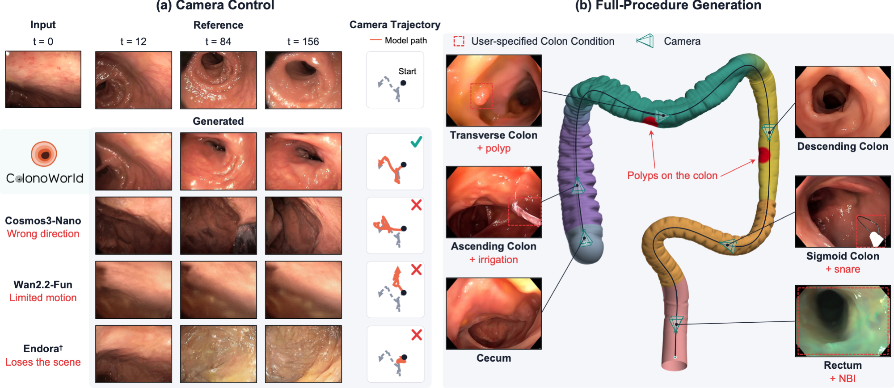
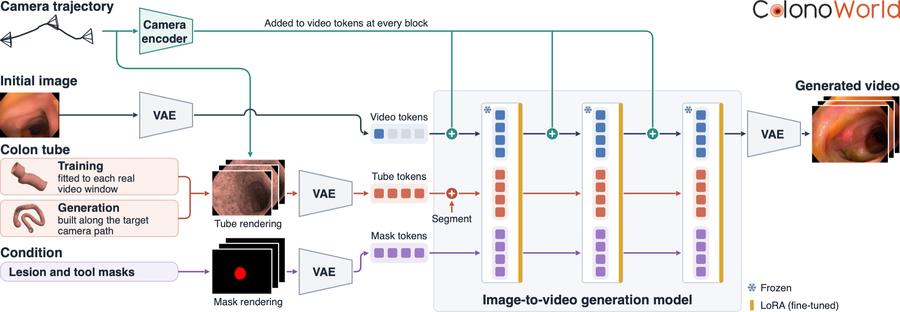
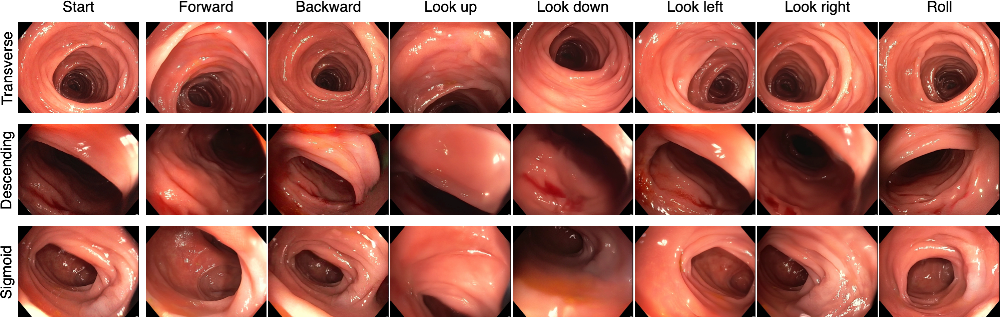
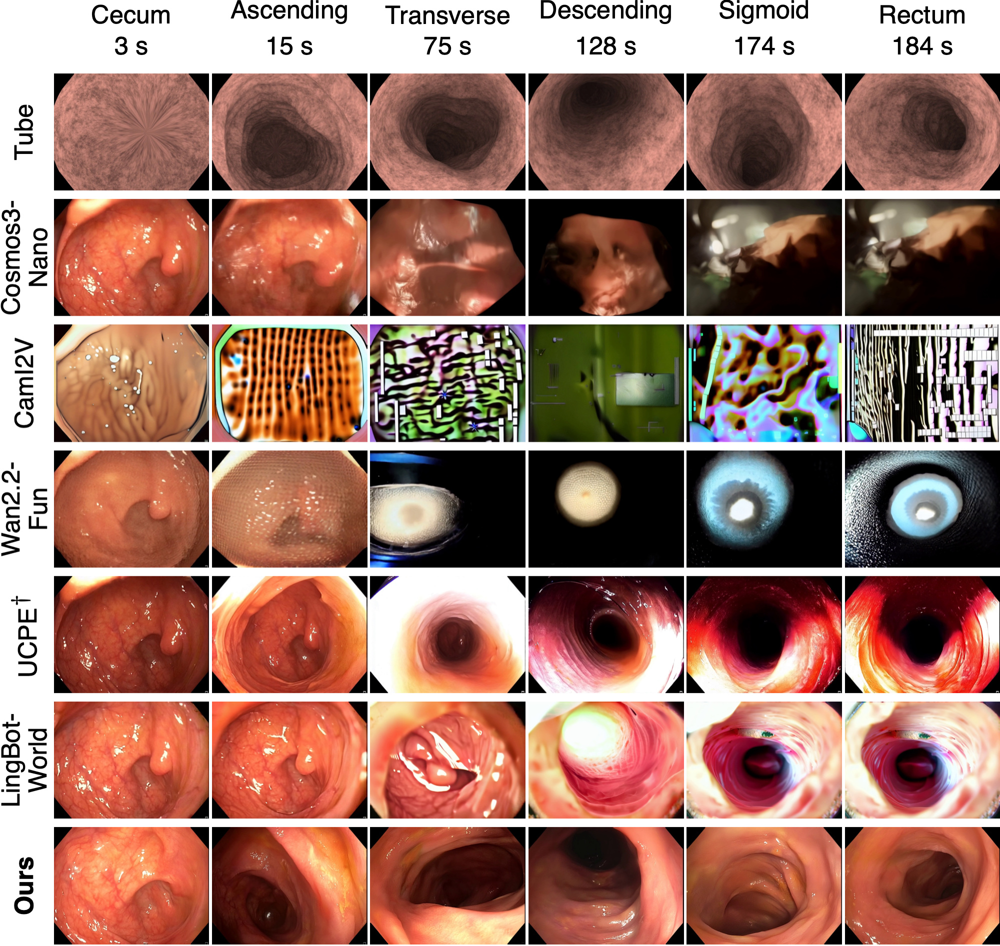

# ColonoWorld: Camera-Controlled Full-Procedure Colonoscopy Video Generation

ColonoWorld generates colonoscopy video from a first frame, a camera trajectory and a rendered 3D
lumen model (the *tube*). Chunks are chained into a full cecum-to-rectum withdrawal. Optional
condition masks add polyps, tools, snares and irrigation, and a global flag switches to
narrow-band imaging (NBI).

<p align="center"></p>
<p align="center"><em>Generated videos are on the project page (link: coming soon).</em></p>

## Method

<p align="center"></p>

The model is built on the NVIDIA Cosmos video world model. It conditions the generator with:

- **Camera:** Plücker rays from the fisheye (KB4) camera path, added in every transformer block.
- **Tube:** the lumen wall rendered along the camera path, VAE-encoded and appended as condition
  tokens that share positions with the target video.
- **Condition masks:** a palette video (polyp, tool, snare, irrigation) encoded as a second
  condition stream.
- **NBI flag:** a global adapter on the target tokens.

Tube and mask guidance are composed as `v = v0 + s_t (v_T - v0) + s_m (v_TM - v_T)`.

## Results

**Camera control.** Generated videos follow the commanded camera motion.

<p align="center"></p>

**Full procedure.** Chained chunks form a full cecum-to-rectum withdrawal.

<p align="center"></p>

## Repository layout

```
colonoworld/
  models/       model, camera/tube/mask/NBI conditioning, checkpoint loading, guidance
  inference/    single-chunk generation and the full-procedure chain
  tube/         tube from a video, training tubes, synthetic full-colon shapes, renderer
  conditions/   mask palette, polyp and snare inserts
  training/     data preparation, joint-conditioning training
  eval/         RotErr / TransErr / CamMC, FVD / FID / IS, lumen following
configs/        YAML configuration for every entry point
scripts/        command-line entry points
docs/           detailed usage per component
tests/          smoke test
```

## Installation

```bash
git clone https://github.com/AIDASLab/ColonoWorld.git
cd ColonoWorld
conda env create -f environment.yml
conda activate colonoworld
pip install -e .
```

ColonoWorld runs on top of [NVIDIA cosmos-framework](https://github.com/NVIDIA/cosmos-framework);
install it following its instructions. Polyp inserts and tube rendering use Mitsuba 3
(`pip install -e ".[render]"`).

### Weights and data

| Item | Where | Config variable |
|---|---|---|
| Cosmos base model, VAE and text tokenizer | NVIDIA Cosmos release (NVIDIA Open Model License) | `COSMOS_WEIGHTS` |
| ColonoWorld checkpoint (`colonoworld.pt`) | download link: *coming soon* | `COLONOWORLD_CKPT` |
| Tube priors and motion library | download link: *coming soon* | `COLONOWORLD_DATA` |
| Colonoscopy videos | [REAL-Colon](https://figshare.com/articles/media/REAL-colon_dataset/22202866) | `COLONOWORLD_DATA` |
| I3D and Inception weights (evaluation) | see `docs/evaluation.md` | `COLONOWORLD_DATA` |

```bash
export COSMOS_WEIGHTS=/path/to/cosmos
export COLONOWORLD_CKPT=/path/to/colonoworld.pt
export COLONOWORLD_DATA=/path/to/data
```

The tube priors and the motion library are derived from REAL-Colon (Biffi et al., 2024),
CC BY 4.0. The mucosa texture and the full-colon donor template are built locally with
`scripts/build_tube_assets.py` (see `docs/tube.md`); the REAL-Colon windows they use are listed
in `data/realcolon_windows.yaml`. Video frames are not distributed: start frames are taken from
your own REAL-Colon download with `scripts/extract_realcolon_frame.py` (see `docs/inference.md`).

## Quick start

Generate one 189-frame chunk from a first frame, a camera path and a tube:

```bash
python scripts/generate.py --config configs/inference.yaml \
    inputs.first_frame=frame0.png inputs.cameras=cameras.npy inputs.intrinsics=calib.json \
    inputs.tube=tube.npz output.dir=outputs/chunk
```

Generate a full withdrawal along a synthetic colon:

```bash
python scripts/generate_full_procedure.py --config configs/full_procedure.yaml \
    --shape standard --frame0 ${COLONOWORLD_DATA}/full_procedure/cecum_frame0.png \
    --out outputs/full_procedure/standard
```

Shapes: `standard`, `u_shaped`, `v_shaped`, `short_compact`, `twisted`, `long_sigmoid` and
`textbook` (anatomical segment labels). See `docs/inference.md` and `docs/full_colon.md`.

## Inference examples

**Polyp.** Insert a polyp onto the 3D wall and generate with the mask stream (mask CFG 3):

```bash
python scripts/build_polyp_insert.py --config configs/conditions.yaml \
    --surface outputs/training_tubes/<window>/surface.npz --intrinsics calib.json --pixel 480 529 --place-frame 94 \
    --size-mm auto --onset 13 --out outputs/polyp
python scripts/generate.py --config configs/inference.yaml \
    inputs.first_frame=frame0.png inputs.cameras=cameras.npy inputs.intrinsics=calib.json \
    inputs.tube=tube.npz inputs.mask=outputs/polyp/cond.npz output.dir=outputs/polyp_video
```

**Snare.** A 3D snare leaving the working channel, with a sheath tool mask:

```bash
python scripts/build_snare_insert.py --config configs/conditions.yaml \
    --intrinsics calib.json --base-cond cond.npz --onset 30 --offset 170 --out outputs/snare
```

**NBI.** Add `inputs.nbi=true` to a single-chunk command; for the full procedure, set `nbi` per
chunk in the conditions manifest (`docs/inference.md`).

**Tube from a real clip.** Build the tube from the first frame and the camera path of a video:

```bash
python scripts/build_tube.py --config configs/tube.yaml --video clip.mp4 \
    --camera-path camera_path.npz --calibration calib.json --segment sigmoid --out outputs/tube
```

**Conditioned full procedure.** Pass per-chunk masks and NBI flags with a conditions manifest:

```bash
python scripts/generate_full_procedure.py --config configs/full_procedure.yaml \
    --shape textbook --frame0 ${COLONOWORLD_DATA}/full_procedure/cecum_frame0.png \
    --conditions conditions.json chain.seed_stride=1
```

## Training

```bash
python scripts/prepare_data.py --config configs/train_joint.yaml --index windows.jsonl \
    --out ${COLONOWORLD_DATA}/train --cache-latents
torchrun --nproc_per_node=8 scripts/train.py --config configs/train_joint.yaml
```

Joint-conditioning training samples five strata (clean 0.30, polyp 0.25, irrigation 0.15,
tool 0.15, NBI 0.15) and uses condition dropout, forward-motion reweighting and EMA. See
`docs/training.md`.

## Evaluation

```bash
python scripts/evaluate.py camera  --config configs/eval.yaml --manifest camera.csv  --out results/
python scripts/evaluate.py quality --config configs/eval.yaml --manifest quality.csv --out results/
python scripts/evaluate.py lumen   --config configs/eval.yaml --manifest lumen.csv   --out results/
```

Camera metrics (RotErr, TransErr, CamMC) compare the camera path read back from the generated
video with the commanded path. Video quality uses FVD (I3D), FID and IS (Inception) inside the
endoscope field. See `docs/evaluation.md`.

## Tests

```bash
pip install -e ".[dev]"
pytest tests
```

## Citation

```bibtex
@article{hong2026colonoworld,
  title   = {ColonoWorld: Camera-Controlled Full-Procedure
             Colonoscopy Video Generation},
  author  = {Hong, Jihwan and Cho, Sunghwan Steve and Ho, Ping Shu and
             Kim, Joo Seong and Kim, Bokyung and Kim, Nam-Joon and
             See, Simon and Kim, Ji Won and Do, Jaeyoung},
  year    = {2026}
}
```

## Licence

The code in this repository is released under the
[Creative Commons Attribution-NonCommercial 4.0 International](LICENSE) licence
(SPDX: `CC-BY-NC-4.0`). The Cosmos base model weights follow the NVIDIA Open Model License.
Datasets follow their own terms: REAL-Colon ([Biffi et al., Scientific Data 2024](https://doi.org/10.1038/s41597-024-03359-0)) is distributed under CC BY 4.0.

## Acknowledgements

This work builds on [NVIDIA Cosmos](https://github.com/NVIDIA/cosmos-framework) and uses the
[REAL-Colon](https://figshare.com/articles/media/REAL-colon_dataset/22202866) dataset.
